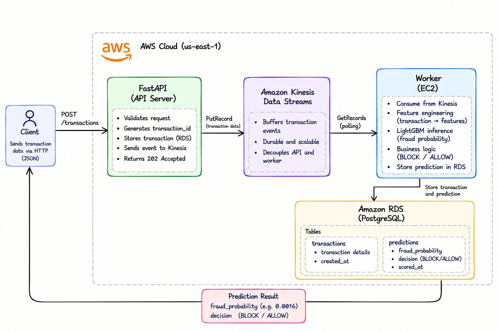
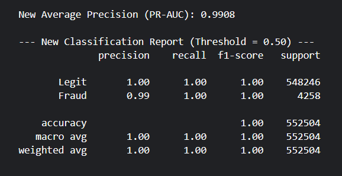
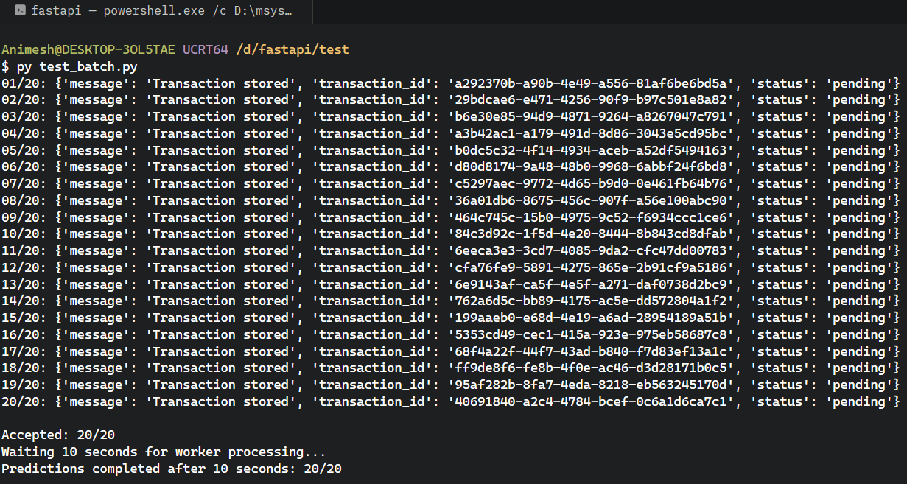
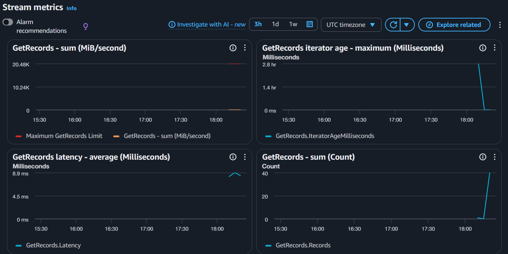

# Real-Time Financial Fraud Detection Pipeline

## Overview

A complete streaming machine learning pipeline which takes in financial transactions via FastAPI, stores these in Amazon Kinesis Data Streams, performs the scoring using a LightGBM model on an EC2 worker and saves the predictions into a PostgreSQL database on Amazon RDS.

Provides a probability that the transaction is fraudulent and automatically decides whether to BLOCK or ALLOW the transaction.

## Architecture

  

**Ingestion:** FastAPI running on Amazon EC2
**Streaming:** Amazon Kinesis Data Streams
**Inference:** Python worker on Amazon EC2 using LightGBM
**Storage:** Amazon RDS for PostgreSQL
**Output:** Fraud probability and `BLOCK` / `ALLOW` decision

### Transaction Flow

1. A client submits a transaction to `POST /transactions`.
2. FastAPI validates the request, generates a transaction ID, and stores the transaction in PostgreSQL.
3. The API publishes the transaction event to Kinesis Data Streams.
4. The EC2 worker consumes events from Kinesis and performs feature engineering.
5. The LightGBM model generates a fraud probability.
6. Business logic converts the score into a `BLOCK` or `ALLOW` decision.
7. The worker stores the prediction in PostgreSQL.
8. The client retrieves the result through `GET /predictions/{transaction_id}`.

## Model Performance

The system uses a trained LightGBM model to score incoming financial transactions.

- **Model:** LightGBM
- **Dataset:** PaySim financial transaction data
- **Inference:** Asynchronous, event-driven processing through Kinesis
- **Output:** Fraud probability and automated decision

Reported model evaluation metrics:

- **PR-AUC:** 0.9908
- **Precision:** 0.99
- **Recall:** 1.00

Key Insight: A contextual feature was created during my feature engineering process called `drained_to_customer`. This is a feature designed to help identify legitimate changes in balance vs suspicious activity. The training and evaluation outputs show the results of the model. You can take these into account when claiming how much fewer false positives we have.

## Streaming Metrics (AWS)

A functional batch test was performed against the deployed API.

**Transactions submitted:** 20 per batch
**API acceptance:** 20/20 in the observed batch
**Predictions completed within 10 seconds:** 20/20
**Database records:** 41 transactions and 41 predictions after two batches and the initial test transaction
**Kinesis monitoring:** CloudWatch showed `GetRecords` activity, approximately 8–9 ms at the visible latency data points, and iterator age falling to near zero after the worker caught up.

Note that 8-9ms refers to the observed latency of the Kinesis GetRecords API.

Throughput (transactions/second), mean inference latency, and overall cost of running experiments on AWS were not measured independently.

## Database Outputs

Data is stored in PostgreSQL across two tables: `transactions` and `predictions`.

- `**transactions**` stores transaction details and their creation timestamps.
    
- `**predictions**` stores the following information:
    
    - `transaction_id`
        
    - `fraud_probability`
        
    - `decision` (`BLOCK` / `ALLOW`)
        
    - `scored_at`

The database was verified to contain **41 transactions and 41 predictions**. This confirms that the worker's fraud scores and decisions were persisted and could be retrieved through the API.

## Deployment

The system was deployed on AWS using infrastructure managed with Terraform. The following services were used:

- **Amazon EC2:** Hosted the FastAPI service and inference worker.
- **Amazon Kinesis Data Streams:** Buffered transaction events between ingestion and inference.
- **Amazon RDS for PostgreSQL:** Stored transactions and prediction results.
- **AWS IAM roles and security groups:** Managed service permissions and network access.

The AWS infrastructure was destroyed after testing.
